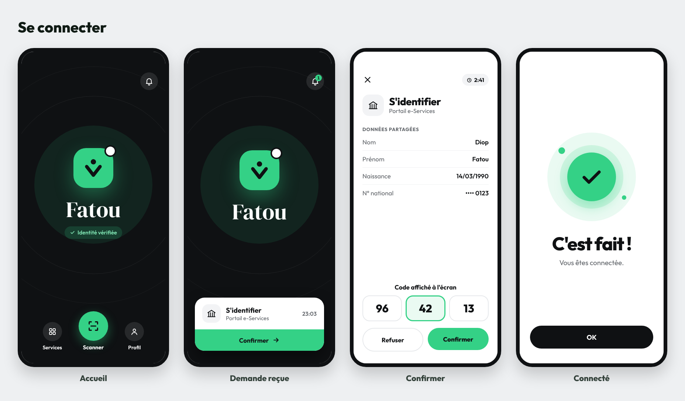

# Vivant

Identité numérique vérifiée pour l'Afrique : la personne prouve qui elle est avec sa carte d'identité, son visage et son téléphone, puis se connecte aux services en ligne (administrations, banques, assurances) en un toucher.

| Dossier | Contenu |
|---|---|
| [`backend/`](backend/) | Serveur Go : inscription vérifiée, fournisseur OpenID Connect, API simple et espace partenaires, documentation |
| [`design/maquettes/`](design/maquettes/) | Maquettes de l'application mobile (16 écrans) |
| [`design/captures/`](design/captures/) | Captures de l'application et de l'espace partenaires |

Démarrage rapide : voir [`backend/README.md`](backend/README.md).

```bash
cd backend
make server    # http://localhost:8080 (partenaires : /partenaires, documentation : /docs)
make test
```


